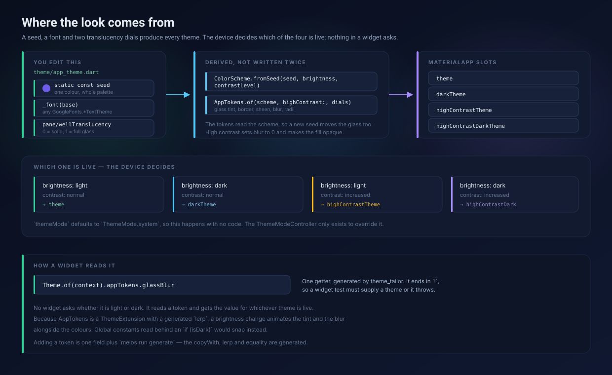
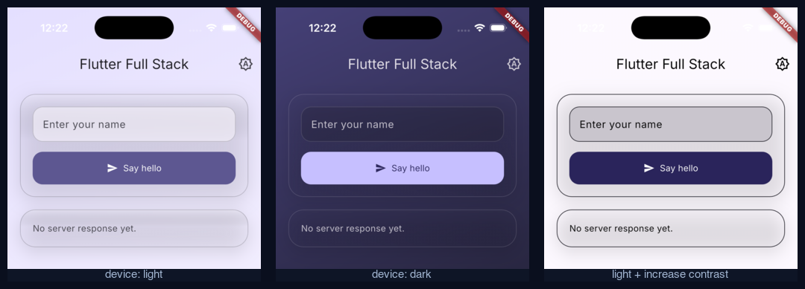

# Theming

Two knobs produce the whole look: the brand colours (CNA's red and blue) and a
font call. Everything else — light, dark, both high-contrast variants, and the
glass — is derived from them.



## What a token is

A *design token* is a named value at the bottom of a design system: not
`Color(0x66FFFFFF)` and `blur: 10` spread across the widgets that happen to
need them, but a name for the intent — `glassTint`, `glassBlur` — that screens
quote instead.

The reason to bother is the direction changes travel. With literals, changing
how the glass looks means finding every call site that passes a number, and
staying consistent depends on everyone typing the same one. With tokens it is
one file, and consistency is the default rather than an act of discipline.

`ThemeData` is already a token system in this sense — `colorScheme.primary` and
`textTheme.bodyMedium` are tokens. What it lacks is a slot for anything
Material does not have a concept of: there is no `ThemeData.glassBlur`. A
`ThemeExtension` is Flutter's own answer to that, which is why the file is
called `app_tokens`: these are *this app's* tokens, the complement to the ones
Material already provides.

Three properties are what make the name honest here:

- **Named for intent, not value.** `glassHighlight` says what the colour is
  for. `Colors.white.withValues(alpha: 0.35)` says how it is currently
  achieved, and stops being true the moment dark mode wants something else.
- **One origin.** Every token is derived from the `ColorScheme`, which comes
  from the brand colours. They are not a second palette that can drift from
  the first.
- **Coherent variants.** The same `glassBlur` is 14 in light, 18 in dark and 0
  in high contrast. A widget asks for the token and gets the value for
  whichever theme is live.

That last one is why no screen in this app contains an `if (isDark)`. The
widget declares *what it wants*; the theme decides *how much it is*.

The word is industry vocabulary rather than a Flutter term — it is what
designers and developers can both say, and Material 3 describes its own palette
that way. `AppStyle` or `AppSurfaces` would mean nearly the same thing if the
team prefers plainer names.

## Where it lives

| File | Role |
|---|---|
| `lib/theme/app_theme.dart` | the two knobs, and the four `ThemeData` |
| `lib/theme/app_tokens.dart` | the tokens Material has no slot for |
| `lib/theme/app_tokens.tailor.dart` | generated — `copyWith`, `lerp`, equality |
| `lib/theme/glass_surface.dart` | the translucent pane |
| `lib/theme/aurora_backdrop.dart` | the surface a screen sits on |
| `lib/theme/rise_in.dart` | the staggered entrance |
| `lib/theme/scene_tone.dart` | the lightness band a prompt's scene is painted in |
| `lib/features/pronunciation/presentation/scenes/` | the isometric kit (`iso_stage.dart`), the story model (`script.dart`: acts, cues) and one file per prompt topic |
| `lib/theme/theme_mode_controller.dart` | lets a user override the device |
| `assets/fonts/` | Inter, bundled, plus its OFL licence |

## Changing the look

**Colours.** The app wears CNA's colours, taken from cna.com.br's own
stylesheet and kept in `Brand` in `app_theme.dart`:

| | Token on cna.com.br | Value | Used for |
|---|---|---|---|
| `Brand.red` | `--color-cna-red-6` | `#ED1941` | what to do: the record button, the active page dot, focus |
| `Brand.blue` | `--color-cna-blue-brand` | `#2E2C83` | everything calmer: the listen button, the light behind the page |
| `Brand.night` | its dark sections | `#01102E` | what the dark theme's surfaces are built up from |

`AppTheme._scheme` builds the `ColorScheme` in two steps:

1. Material's tonal algorithm lays out the families, seeded with each brand
   colour. Red becomes the primary family and blue the secondary family and
   the neutrals. It uses `DynamicSchemeVariant.fidelity`, so each colour
   keeps its hue instead of being rotated into another one.
2. Outside high contrast, the brand's own tones replace the ones the
   algorithm would have softened away. Left alone, a dark theme's primary
   would be a pale pink and its surfaces a neutral grey instead of CNA's
   navy.

Under high contrast, Material's tones are kept, because they are what that
request is for. Every token in `AppTokens.of` derives from the scheme, so the
glass and the aurora follow it. The aurora is two blues with a small red ember
at the side, and the page gradient comes down from the blue. Red over blue
mixes to magenta, and a page that reads purple is not CNA's.

One trade-off to know about: in the dark theme the primary is `#F22B4C` with
dark ink on it, rather than the brand's `#ED1941` with white. No single red can
both carry white text at AA and be read as text on the night. This one manages
4.7:1 both ways and is a hair away from the brand's red.
`test/theme_contrast_test.dart` holds every pairing to WCAG AA in all four
themes, so a colour nudged too far fails `melos run check`.

**Font.** One line, same file:

```dart
static TextTheme _font(TextTheme base) => GoogleFonts.interTextTheme(base);
```

Any `GoogleFonts.*TextTheme` works — but the faces are bundled, so a new
family also means new files in `assets/fonts/`. See *Adding a font weight*.

**How see-through the surfaces are.** Two knobs, because the two materials
want different answers:

```dart
static const paneTranslucency = 1.0;  // cards
static const wellTranslucency = 1.0;  // fields
```

`0` is fully opaque, `1` is as glassy as the design goes. Lowering
`paneTranslucency` also lowers the blur proportionally — a frost that nothing
shows through is a `BackdropFilter` paying for an effect no one can see, and at
`0` none is inserted at all. Measured on the light scheme:

| knob | 1.0 | 0.5 | 0.0 |
|---|---|---|---|
| pane fill alpha | 0.55 | 0.78 | 1.00 |
| well fill alpha | 0.82 | 0.91 | 1.00 |
| blur sigma | 14 | 7 | 0 |

Reach for `wellTranslucency` first if typed text is hard to read against a busy
backdrop. A field is about legibility before it is about looking good.

**There is a guard on this.** A translucent surface has no contrast ratio of
its own — what the reader sees is the fill composited over whatever is behind
it — so dialling either knob too far can quietly push text below WCAG AA with
nothing failing to say so. `test/theme_contrast_test.dart` composites both
materials over the strongest aurora pool, in all four themes, and asserts at
least 4.5:1 against `onSurface`. At the defaults it measures 13.0:1 on a light
field and 6.0:1 on a dark one; if a change takes it under 4.5, `melos run
check` fails.

The same test holds the scene drawn behind an English practice prompt — a
small isometric island in a sky of its own, full-bleed and opaque, so it is
what the glass shows through and what the app bar's icons sit on. It is not
vetted colour by colour. It is confined to a *band of lightness*
(`sceneLow`, `sceneHigh`, in CIE L*) that `AppTokens.of` derives from the text
colours, so that **anything** painted inside it keeps `onSurface` and
`onSurfaceVariant` at 4.5:1, bare and through the glass, errors on a card at
4.5:1, and the score colours (24 px and up, so large text) at 3:1. On a light
theme that band is L* ≈ 78–98, airy pastels; on a dark one L* ≈ 5–32, deep
jewel tones. Any hue fits, which is what lets the scenes be colourful.

There are two bands, because the screen asks two different things of the
scene. The **sky** — behind the deck, the page dots and the app bar's icons —
keeps the narrow band above, and stays calm. The **world** on the island is
where the sentence is acted out, and it gets a far wider one (`worldLow`,
`worldHigh`: L* 36–98 light, 5–68 dark) so it can have real light: sun-struck
roofs, deep shadows, windows that glow. Nothing is read straight off the
world. The sentence and every pane over it use `glassDense`, a frosted glass
(surface at 0.86 light, 0.74 dark) that keeps all text at AA over anything the
world band can paint — and that makes the sentence the one solid, still thing
on a lively screen. The kit picks the band by *where* something is drawn
(inside `IsoStage.rising` is world), so a scene never chooses.

Scenes never hold a `Color`: they ask for a `Tint` — a hue, a saturation and a
level within the band — and `SceneTone` (`lib/theme/scene_tone.dart`) makes
the colour for the live theme. Three numbers in it were measured, not chosen:
the margin is 5 L* on light and 3 on dark, because the light glass is denser
and composites a saturated green darker than its lightness promises;
saturation is capped at 0.85, because at full saturation a channel drops to
zero and the same thing happens; and `level` is bent by a gamma (1.7 light,
0.8 dark) so the middle levels a scene uses most have body on both themes.
`test/theme_contrast_test.dart` sweeps the band, every 15° of hue, and
`prompt_scene_test.dart` checks that every scene, at rest, paints inside it.

The scene exists to show the learner what the sentence *says*, so it is
staged as a story in two acts (`Act` in `iso_stage.dart`). In the first, the
world assembles — quickly, inside `IsoStage.setting`, which plays a scene's
whole assembly on a timeline of its own in the first third of the arrival.
In the second, the sentence is acted out on its own: the car drives in, the
light turns red, the car stops. It is lit for it — a warm `pool` of light
under the subject, a `glow` where a lamp comes on, and a `spotlight` that
lets the rest of the island sink a little into the page's own colour (a
third as much on a light page, where a pale veil would wash the day out).
Each beat is a `Cue` (`script.dart`): the words of the sentence it shows
and the moment it happens; `scene_script_test.dart` checks that every cue is
still in its sentence when the content is reworded. The card itself is left
alone while the story plays — green, amber and red on its words mean how
they were said, and nothing else may borrow colour there — so the light in
the scene is what points the learner at what the sentence says.

**A new token.** Add the field, run the generator:

```dart
@override
final double gutter;
```

`melos run generate` writes the `copyWith`, `lerp` and equality for it. Two
things the compiler will remind you of: the field needs `@override`, because the
generated mixin declares it abstract, and it has to be set in both branches of
`AppTokens.of`.

## The four themes, and who picks

A device asks for more than light or dark: it can also ask for increased
contrast. `MaterialApp` has a slot for each combination, all four built from the
same brand colours by the same function, so they cannot drift apart.

`themeMode` defaults to `ThemeMode.system`, which means following the device
costs nothing — no provider, no listener. `ThemeModeController` exists only so a
user can *override* it, and the choice is deliberately not persisted; that would
need a storage dependency the app does not have yet.

The theme button is a switch between the two brightnesses, not a cycle through
the three modes: every tap flips what is on screen, light to dark or dark to
light (`ThemeModeController.toggle`). It used to cycle system → dark → light →
system on a light device, and the last step changed the state but nothing on
screen, because following a light device looks exactly like pinned light. A tap
that changes nothing reads as a tap that was missed, so users had to press twice.
Following the device is still the default, and flipping back to the device's own
brightness returns to `system` rather than pinning it, so the app keeps following
a device that turns dark at night. The icon and tooltip say what a tap will do:
the moon while light, the sun while dark. `test/follow_the_device_test.dart`
pins this from both device settings, and after the device changes under a pinned
choice. The language button in `LocaleController` still cycles, ordered against
the device so that its first tap always changes the copy.

These are real screenshots of the app, taken by flipping the simulator's own
appearance and "Increase Contrast" settings:



Look at the third one. The glass is gone: the pane is opaque, the border is
hard, the gradient is flat. That is not a special case in the screen's code —
`AppTokens.of` returns `glassBlur: 0` and an opaque fill when the device asks
for contrast, and `GlassSurface` skips the `BackdropFilter` entirely when the
blur is zero. **A translucent surface cannot honour a contrast request, so it
stops being translucent.** No widget branches on it.

## Reading tokens

```dart
final tokens = Theme.of(context).appTokens;
```

One getter, generated. A widget never asks whether it is light or dark — it
reads a token and gets the value for whichever theme is live.

That is the reason the tokens are a `ThemeExtension` rather than global
constants behind an `if (isDark)`. When the device flips at sunset, Flutter
animates between the two `ThemeData`, and the generated `lerp` carries the glass
tint and blur along with the colours. Constants would snap mid-transition.

## Two materials

The design system has two surface treatments, and which one to use is not a
style choice — it says what the surface does.

| | **Well** — `wellFill`, `wellBorder` | **Pane** — `GlassSurface` |
|---|---|---|
| Reads as | recessed | raised |
| Cues | denser fill, crisp border, no sheen | outer shadow, sheen along the top |
| Radius | `radiusMedium` | `radiusLarge` |
| For | anything the user types into | anything that displays |

Getting this backwards is a specific, recognisable mistake: an input wrapped in
a `GlassSurface` gets an outer shadow and a highlight running across exactly
where the text sits, so it reads as a decorative tile that happens to contain a
placeholder rather than as something to type in. Fields carry the theme's own
`inputDecorationTheme`, which is the well, and are not wrapped in a pane.

## Using the glass

```dart
Scaffold(
  extendBodyBehindAppBar: true,   // so the backdrop runs under the bar
  appBar: AppBar(title: const Text('...')),
  body: AuroraBackdrop(
    child: GlassSurface(child: ...),
  ),
)
```

`AuroraBackdrop` is not decoration. `GlassSurface` blurs what is behind it, so
over a flat background it reads as flat translucent paint rather than glass. The
backdrop is three overlapping pools of colour rather than one linear wash,
because that is what gives the blur something with structure to refract.

`GlassSurface` takes an `onTap`. Without it there is no gesture handling and no
animation controller at all — the pane has no idle animation on purpose, because
one that pulses forever costs a repaint every frame for the life of the screen,
multiplied by the number of panes on it. With `onTap` it gets an ink ripple and
a small press scale, and that scale is skipped when the device asks for reduced
motion.

**Fade glass with `Reveal`, never with `Opacity`, `FadeTransition` or
`AnimatedOpacity`.** A `BackdropFilter` under an opacity layer blurs nothing,
because the layer is drawn on its own canvas and that canvas is all the filter
sees. A pane faded that way stays clear and darkened for the whole fade, then
frosts all at once on the last frame, when the opacity reaches one and the
layer is dropped. Every pane that rose in or switched used to do this.

`Reveal` fades its child normally, except when there is glass in it. The glass
claims the reveal and fades itself from beneath the filter: blur, tint, edge
and content together, with the blur following the square of the fade so it
does not arrive ahead of the tint. `RiseIn` fades through a `Reveal`, so it
needs nothing from you. For an `AnimatedSwitcher` over glass, pass
`transitionBuilder: (child, animation) => Reveal(opacity: animation, child: child)`.

Keep glass in a reveal of its own. Anything else inside a reveal that glass has
claimed stops fading with it. `test/theme/glass_reveal_test.dart` measures the
blur frame by frame, so a pane that frosts with a jump fails it.

## Adding a font weight

The filenames are not arbitrary. `google_fonts` finds a bundled face by
matching the end of the asset path against `Family-Variant`, using its own
variant names — `Regular`, `Medium`, `SemiBold`, `Bold`, and so on. Rename a
file and it stops being found.

The safe way to get one is the URL the package itself would fetch, which lets
you verify what you downloaded:

```bash
# hash and size come from google_fonts' own descriptor for the family
curl -sL -o assets/fonts/Inter-ExtraBold.ttf \
  https://fonts.gstatic.com/s/a/<hash>.ttf
shasum -a 256 assets/fonts/Inter-ExtraBold.ttf   # must equal <hash>
```

`assets/fonts/` is declared as a folder in `pubspec.yaml`, so a new file needs
no pubspec change — only `flutter pub get` to pick it up. `OFL.txt` lives
beside the fonts because Inter is licensed under the SIL Open Font License, and
redistributing it means shipping that licence.

Changing family entirely means changing `_font` in `app_theme.dart` *and*
replacing the files, since the bundled faces are family-specific.

## Motion

The rule is that motion has to mean something. These places qualify, and
nothing else moves:

| Moment | What happens |
|---|---|
| Arrival | `RiseIn` fades and lifts the headline, the field and the response, staggered ~90ms apart |
| Arrival | `AuroraBackdrop` drifts its three colour pools into place over 2.2s, then stops |
| Choosing a language | Each language is a page of its own, swiped between or picked from the tabs under the headline, with a place where it is spoken filling the screen (`CountryScene`): the Statue of Liberty on her star fort in New York harbour, whose torch flares and fires a rocket that bursts into a heart over the Manhattan skyline, a flamenco dancer spinning in Seville's Plaza de España - its half-ring of brick, the canal and its tiled bridges, a boat rowing round - who strikes her pose, fan open, to a guitar's strum, a Korean temple bell struck with a log as cherry petals fall. The place moves at a little over half the speed of its page, as a view does past a window, and the tabs' pill follows the finger. A place arrives as soon as its page shows at the edge of a swipe, in the prompts' two acts and 3.6 s, and then stops; it tells its story again each time its page comes back. The island stands in the middle of the room the headline, the tabs and the panel leave it (`IsoStage.centred`), all of them measured as laid out, and the panel keeps a breath above the safe area. On a short screen (under 720 dp) the type, the gaps and the panel come down a size; on a screen wider than tall the panel goes to the side and the island takes the height beside it; headline, tabs and panel never grow wider than 560 dp. The landmarks behind each island are placed from the island, not the screen, so they stay beside it wherever the layout puts it. A download fills its own button. Under reduced motion each place is simply there; under high contrast there are none, and the tabs and panels are the whole choice |
| A prompt arrives | `PromptScene` plays the English phrase's story in two acts over 3.6s, then stops: the island assembles in the first ~1.2s, then the sentence is acted out, beat by beat, in a key light; the next prompt cross-fades to its own |
| State change | `AnimatedSwitcher` slides a new response over the old one instead of blinking it into place |
| State change | While the learner records and the attempt is scored, a `sceneHush` veil fades over the scene so the sentence is the one thing in focus, and fades off with the score |
| The learner's moment | A black cat hides somewhere in every English scene, a different place in each — behind the hotel's corner, in the toolbox, on the cottage roof — only a tail tip or its ears showing. It comes out to answer the learner (`HidingCat`), briefly: it washes a paw after 8s on a prompt without starting, gives a slow blink after a weak attempt, and swishes its tail after a strong one — 3.4–4.4s, out and back, once per prompt or attempt, never while recording or scoring. Where it hides at ground level it comes out on foot (`SceneScript(catWalks: true)`): it walks out side on, turns round to the learner as it sits, then gets up and turns about as it walks home in a curve. It is one cat, modelled once in three dimensions and seen from wherever it faces (`CatFigure`): every part has one size, so it is in proportion walking, turning, sitting and gesturing alike, and a turn is seen as a turn rather than a side picture swapped for a front one. `cat_figure_test.dart` holds it to that |
| Swipe | The prompt cards fan like a hand of cards: the one going tips away about the foot of the deck and shrinks a little, the one coming straightens and grows into place. They pass a gutter apart, because the deck runs edge to edge and each card keeps its gutter inside its own page. Only while the finger moves; under reduced motion they simply slide (`_DeckCard`). The swipe works anywhere on the page, as on the language chooser: over the scene, the feedback or the footer it is handed to the deck, so it follows the finger and settles the same way. A swipe that starts on a card stays the deck's own, and a vertical one still scrolls (`_SwipeAnywhere`) |
| A score arrives | No card over the scene, so the island and the cat answering the attempt stay in view. A medal pops in beside the record button: the number counts up inside a ring filling to it, in the band's colour, and one to three stars pop in along its foot. One line rises under the sentence for the word that most needs fixing (`weather /ð/ sounded like /t/`). Tapping a coloured word moves the line to that word and reads it aloud; tapping the medal opens everything else in a sheet |
| Hearing the sentence | Read aloud from the listen button, the sentence plays the same karaoke as a playback of the learner's attempt, before an attempt as much as after one: the word being said hops and is underlined, those still to come wait faded. It follows the speech engine's own word-by-word progress (`PhraseVoice.spoken`), not a guessed timing. The prompt is always laid out a word at a time for this, which also stops it from shifting when a score arrives |
| Hearing yourself | The attempt is a voice message under the sentence: its outline drawn from the recording, each bar in the colour of the word it falls in. Played back, a playhead runs along it, the bars filling in behind it, and the sentence plays karaoke: the word being heard hops up and grows a touch, those still to come wait faded. It is drawn bigger and never laid out bigger, so the sentence does not shuffle. Under reduced motion the word lights without hopping |
| Recording | The record button is held while the learner reads and let go when they are done, as a voice message is sent (`HoldToRecord`). The 15 seconds an attempt may run are strung round it as beads, one a second, faint at rest. Pressed, the button swells and the beads light up round it; while it records, a thread runs round through them and each bead it reaches pops like a soap bubble, so what is left of the string is what is left of the time, and the button counts it down. The last five turn red and the button nudges each second, with a tap on the hand in the last three. Until the first attempt, a bubble over the button offers it with the time there is ("Hold to speak · up to 15 s"). A press shorter than 300 ms was a tap: it is thrown away, the last score comes back, and the bubble says to hold the button, with a shake. A finger drifting sideways is still holding it, not swiping the deck. A screen reader starts it by activating it and stops it by activating it again. The halo ripples while the microphone is open; under reduced motion the beads simply go out, and nothing ripples or nudges |
| Press | `GlassSurface` scales to 0.97 while held, when it has an `onTap` |
| Sound | The scene and the cat are heard only while they move, each sound on the beat its drawing keeps time by, and everything stops before the microphone opens — see [sound.md](sound.md) |

**Nothing animates at rest**, and that is a decision rather than an omission.
(Recording is not rest: the ripple and the beads say the microphone is open, and they stop
the moment that stops being true. Nor is the cat restless: it comes out only to
answer something the learner did, and is back in hiding a moment later.
It is painted from `Tint`s like the rest of the world, so it is as black as
the world band allows — black on a dark page, charcoal on a light one,
where a score pane may come down over it.) A
`BackdropFilter` re-rasterises whatever moves behind it, so a backdrop that
drifts forever costs a blur every frame for the life of the screen — multiplied
by every pane on it. Motion on arrival is paid once.

Every one of those checks `MediaQuery.disableAnimationsOf(context)` first.
Reduced motion is an accessibility setting, not a preference: with it on, the
aurora is already settled, `RiseIn` children are simply there, and the press
scale does not move. Nothing is lost — the states still change, they just do
not travel.

The composition matters as much as the motion. A screen made of equally sized
rounded rectangles at equal spacing reads as generated no matter what it does
on entry, which is why the response is not a permanent box: when there is
nothing to show, it is absent rather than a card saying so.

## Three things that will bite

**A widget test must supply a theme.** The generated getter ends in `!`, so a
bare `MaterialApp` throws rather than falling back:

```dart
MaterialApp(theme: AppTheme.light(), home: const GreetingsScreen())
```

`test/widget_test.dart` shows it. This is the failure you get if you forget:
`_TypeError` while building `AppBackdrop`.

**A font weight that is not bundled throws.** Inter ships in
`assets/fonts/`, and `main.dart` sets
`GoogleFonts.config.allowRuntimeFetching = false`, so nothing reaches the
network for a typeface — no first-run download, no flash of a fallback face.
The cost is that `google_fonts` does *not* fall back to the nearest bundled
weight: ask for one that is missing and it throws, naming the file it wanted.

Four weights are bundled: Regular (400), Medium (500), SemiBold (600) and Bold
(700). 400 and 500 are what Material's own text theme uses; the other two are
there for emphasis. To add one, download it and drop it in — see below.

**The generator writes `*.tailor.dart`, not `*.g.dart`.** It is a second
generated suffix, and the analyzer excludes in
`flutter_full_stack_flutter/analysis_options.yaml` list both. Anything that
reasons about generated files by name has to know about both.
